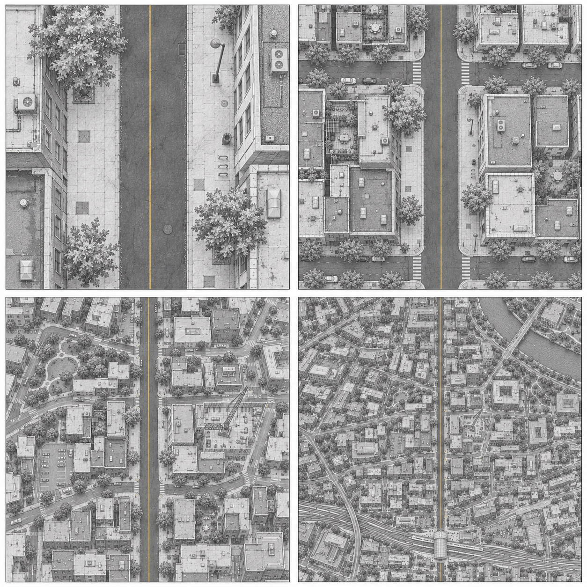
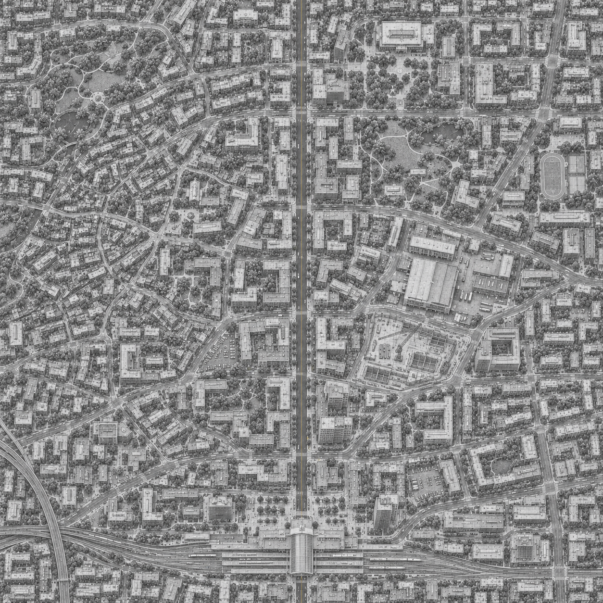
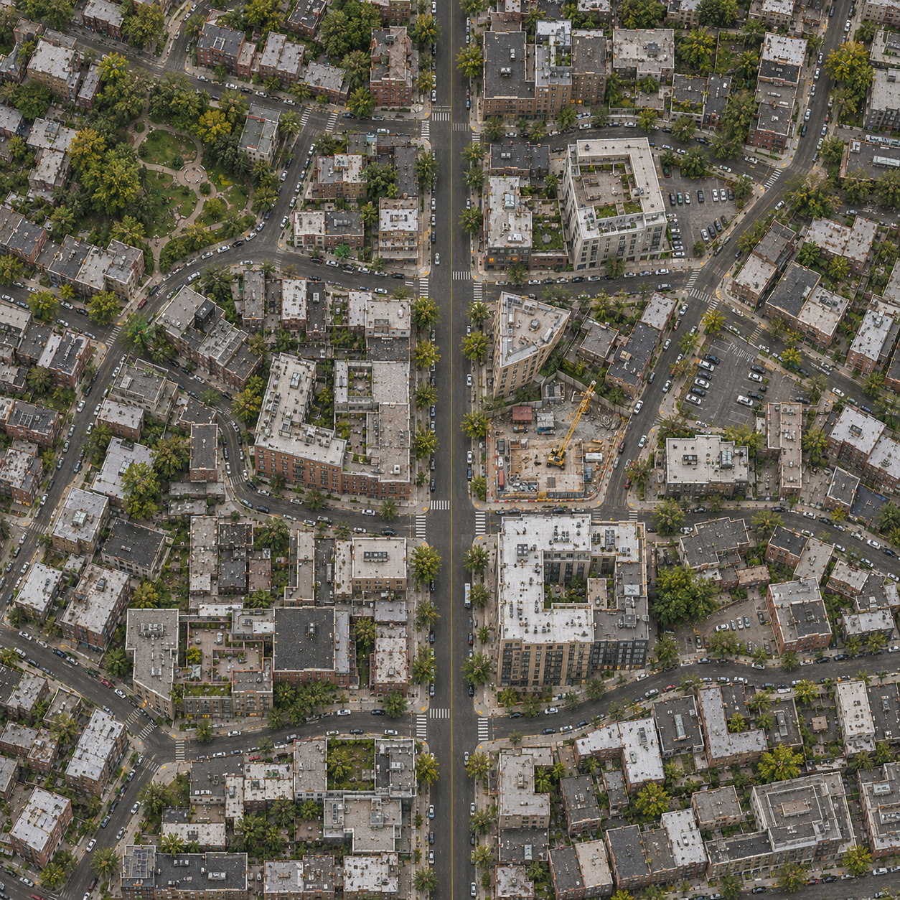
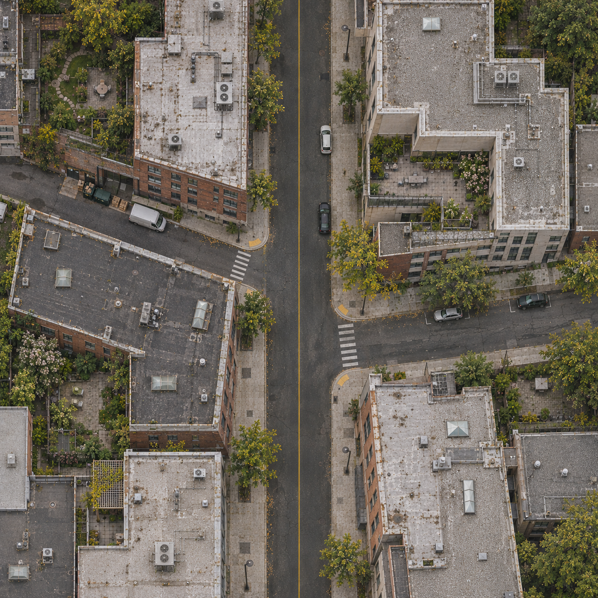
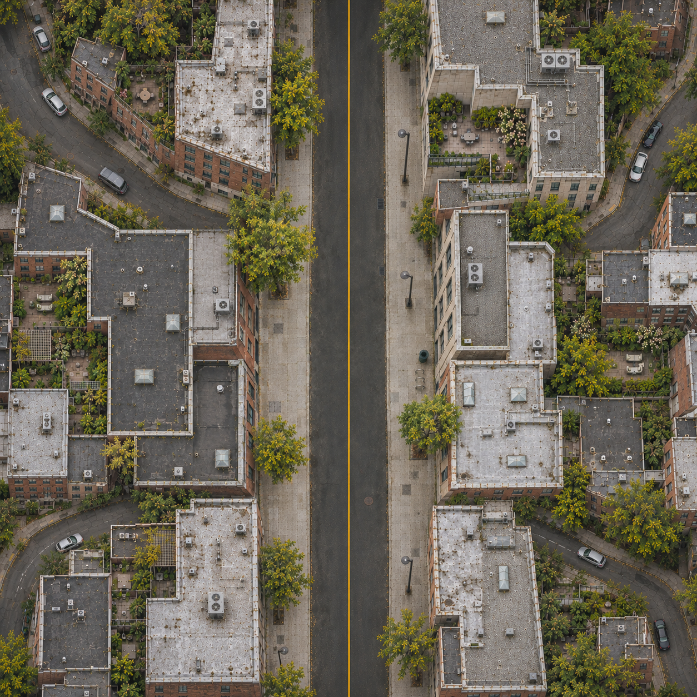
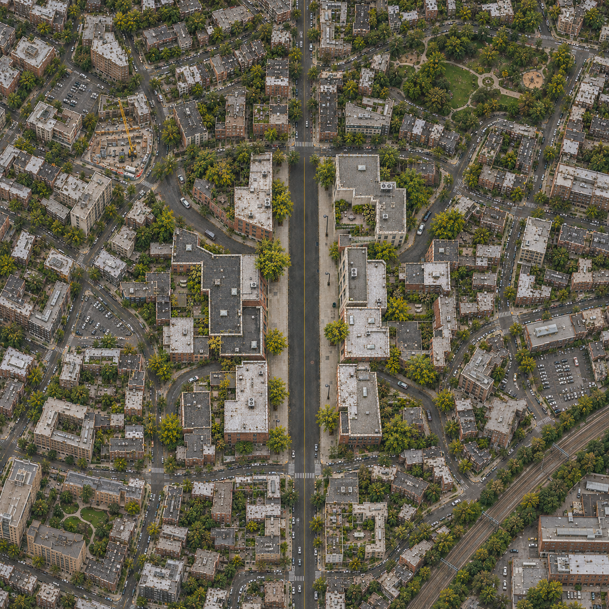

# V3 city ascent storyboard

This storyboard starts the V3 city redesign. V1 and V2 remain frozen. The current V3 Deep Zoom Lab is a separate delivery pilot; this document plans the irregular city artwork that will eventually replace the repetitive city views in the main journey.

## Existing frame audit

The current 27 m frame establishes the street corridor. From 81 m through 2,187 m, the neighborhood expands but relies heavily on a regular, repeated block grid and similar roof shapes. Those saved frames are useful scale references, but not approved composition references for V3.

## Composition direction

Keep a straight-down camera, stable orientation, consistent light and weather, and the same north-south road as the visual spine. Add controlled urban variation around it: unequal blocks, angled secondary streets, offset intersections, different building footprints and roof heights, back lanes, small parking areas, mature tree clusters, a pocket park, construction, rail infrastructure, and mixed urban density. Do not repeat a block template or mirror the left and right sides.

The generated sketches below are composition studies only. They are not scale-accurate frames, do not guarantee exact registration of the road between panels, and are not photoreal final art. Use them to choose city character and neighborhood variety; enforce scale and continuity in the final image master.

### 27 m to 729 m studies

Panel order is 27 m (upper left), 81 m (upper right), 243 m (lower left), and 729 m (lower right). The progression suggests where a cross street, several varied blocks, pocket green space, and broader neighborhood structure can enter the view.

### 2,187 m study

This wider view suggests a more varied urban core with parks, transit, older street patterns, larger commercial footprints, and uneven density. Its apparent road marking is exaggerated by the sketch and must not be copied as scale-accurate detail.

## First photoreal city study

This first image study adds variation in block size, roof shapes, street angles, tree cover, and building height around the central road. It is a 1,254 × 1,254 px single image, not a 3×3 high-resolution master. Its road location is a compositional reference only; it is not pixel-registered to the 81 m frame and is not approved for the live journey or DZI pyramid.

## 81 m anchor candidates

This first candidate is retained as an early study. Its center crop introduces an intersection that does not exist in the 27 m image, so it cannot serve as a continuous anchor.

The second candidate came from a rough nine-region expansion followed by a single-image harmonization pass. Its middle third carries the road, sidewalks, trees, and flanking buildings from the 27 m view at the right threefold scale. The larger view introduces irregular side streets, varied building footprints, courtyards, trees, parking, and uneven block spacing. A manual exact-pixel insertion of the 27 m image produced visible rectangular joins and was rejected; this harmonized candidate is therefore a visual continuity study, not a pixel-locked master. It is 1,254 × 1,254 px and needs a native-resolution art pass before production use.

## 243 m expansion candidate

This 1,254 × 1,254 px image expands the 81 m composition by three in both dimensions. Its middle third follows the 81 m candidate's avenue, rooftops, and block composition closely enough to continue the visual spine, while adding parks, a rail corridor, angled streets, parking, and more varied city blocks. Like the 81 m image, it is an AI-generated preview rather than a registered high-resolution master. The next review should compare both center crops during an actual 3× zoom, then revise the artwork where the road, building edges, or scale cues visibly jump.

## Scale references

Keep the physical road marking fixed at approximately 0.18 m wide. Its fraction of the view width falls by three at every step:

| Square view width | Marking width as a fraction of frame width |
| ---: | ---: |
| 27 m | 0.67% |
| 81 m | 0.22% |
| 243 m | 0.074% |
| 729 m | 0.025% |
| 2,187 m | 0.0082% |

At city scale the marking will become subpixel in the displayed view and should naturally disappear. Do not thicken it for readability.

## Production sequence

1. Approve the central 1 m road artwork and choose its final native resolution.
2. Define each city frame's footprint, composition, and center crop from the fixed threefold scale rule.
3. Create a full-resolution larger master around that registered center. Use the storyboard for irregular city structure, not as image tiles to stitch directly.
4. Harmonize the complete master. A generated harmonization pass may remove obvious panel boundaries, but exact-pixel center insertion can reintroduce a rectangular join. Repair internal joins in the artwork before generating its DZI pyramid; tile overlap can prevent rendering gaps but cannot repair visual seams.
5. Review the final master at native resolution and through the actual zoom, in both directions, before creating the next scale.

The first implementation milestone should be one reviewed city-scale handoff, not replacing every city image at once.
